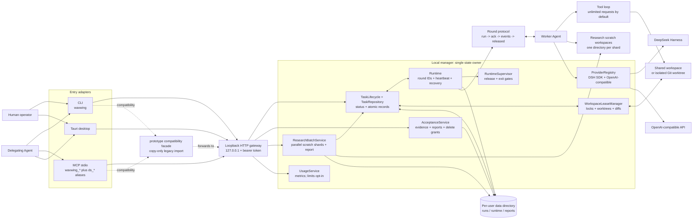
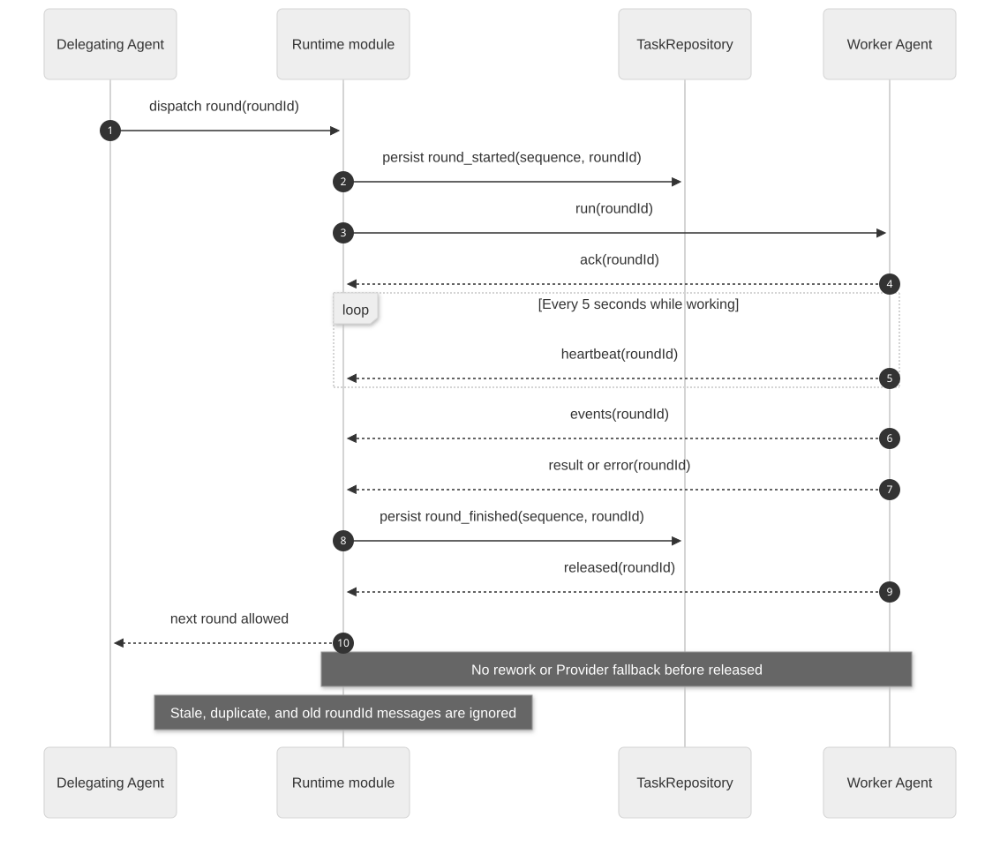

# Waxwing Architecture

Waxwing is a local-first delegation manager. CLI, MCP stdio, and the Tauri
desktop app are adapters over one loopback HTTP manager. The stable `0.1`
surfaces are those adapters; `POST /api` remains an internal, unstable
interface.



## Design boundaries

| Module | Responsibility |
| --- | --- |
| `src/app.mjs` | Public composition root and stable exports |
| `src/adapters/cli.mjs` | CLI adapter; forwards no task-state mutations itself |
| `src/adapters/mcp.mjs` | MCP stdio adapter with `waxwing_*` names and `ds_*` aliases |
| `src/tasks/repository.mjs` | Task index, record validation, atomic `task.json` persistence |
| `src/tasks/lifecycle.mjs` | Legal task-status transitions |
| `src/workspace/lease-manager.mjs` | Exclusive workspace leases, overlap checks, cleanup |
| `src/workspace/git.mjs` | Git probes, base commits, worktrees, status, diff, branches |
| `src/runtime/protocol.mjs` | Round IDs, message validation, heartbeat constants |
| `src/runtime/module.mjs` | Single-round lifecycle: dispatch, ACK, heartbeat, terminal, release, exit, fallback handoff |
| `src/runtime/supervisor.mjs` | Release and confirmed-exit gates used by the runtime module |
| `src/runtime/identity.mjs` | Residual-runtime identity verification |
| `src/acceptance/service.mjs` | Reports, hashes, deletion manifests, human grants |
| `src/research/service.mjs` | Parallel read-only research shards, scratch workspaces, partial results, aggregate reports |
| `src/usage/service.mjs` | Metrics facade; optional thresholds are disabled by default |
| `src/providers/registry.mjs` | Provider discovery and adapter selection |
| `prototype/manager.mjs` | `0.1.x` coordinator and compatibility facade |
| `prototype/` | Legacy entry-point and data compatibility until at least `0.2.0` |

`0.1` uses an incremental extraction rather than a full manager rewrite. The
service files above are the public module boundaries; several implementations
still delegate to battle-tested `prototype/` code. The coordinator remains the
single owner of a task lifecycle, so adapters and desktop commands never write
task state directly.

## System view



The Mermaid source is kept in [assets/architecture.mmd](assets/architecture.mmd).
The checked-in SVG and PNG are rendered from that source so remote Git hosts
that do not render Mermaid still show the architecture.

```bash
npx -y @mermaid-js/mermaid-cli -i docs/assets/architecture.mmd \
  -o docs/assets/system-architecture.svg -b '#fff8fa' -t neutral --size 3000
```

## Single-round protocol

Each dispatch receives an opaque `roundId`. A result is not a release. The next
round, including automatic Provider fallback, may start only after the Worker
Agent relinquishes the previous lease.



The sequence source is kept in
[assets/round-protocol.mmd](assets/round-protocol.mmd).

```bash
npx -y @mermaid-js/mermaid-cli -i docs/assets/round-protocol.mmd \
  -o docs/assets/round-protocol.svg -b '#fff8fa' -t neutral --size 2200
```

```text
manager                         worker
   |-- run(roundId) ------------->|
   |<------------- ack(roundId) ---|
   |<---------- events/heartbeat ---|
   |<---- result|error(roundId) ----|
   |<----------- released(roundId) -|
   |-- next run ------------------->|
```

- A busy Worker Agent returns `worker_busy`; it never silently drops a run.
- The manager records but ignores old, duplicate, or late messages whose
  `roundId` does not match the active lease.
- Every task event has a monotonic `sequence` and a `roundId`.
- Five-second heartbeats update health. Twenty seconds without a heartbeat
  marks the runtime `unhealthy`; it does not terminate the process.
- Runtime records include PID, task ID, start time, active round, and a random
  owner marker. Restart recovery terminates only a verified matching process.
  A live but unverifiable process keeps its workspace lock and requires human
  handling.

## Workspace modes

`workspaceMode=auto` is the default:

- A clean Git repository gets a sibling worktree under
  `.waxwing-worktrees/<task-id>` on branch `waxwing/task-<id>`.
- A non-Git directory uses an exclusive shared-workspace lock.
- A dirty Git repository returns `DIRTY_WORKSPACE`; the caller must explicitly
  select `shared` or clean the repository.

Acceptance and close stop the runtime but retain the worktree and branch.
`cleanup_worktree` removes only a clean worktree and never deletes the branch.

## Parallel research batches

`research_start` fans one read-only question out to multiple execution Agents.
Every shard receives a separate scratch workspace below
`<WAXWING_RESEARCH_ROOT>` (default `<WAXWING_HOME>-research`). Source projects
are referenced by URL or prompt and are not writable shared directories.

- Shards are dispatched concurrently through the same manager.
- `research_wait` blocks server-side until the batch settles or the caller's
  timeout expires.
- Successful shard runtimes close automatically after their result is captured.
- A failed shard does not discard results from completed shards.
- `research_collect` writes one aggregate report under `<WAXWING_HOME>/reports`
  and returns a bounded page plus a content hash.
- `research_cancel` stops unfinished shards and retains completed evidence.

This supports parallel reading, source comparison, and synthesis. It does not
allow multiple execution Agents to write concurrently in one physical project
directory. Write tasks use separate worktrees or an explicitly serialized
`shared` workspace.

## Relationship to adjacent projects

| Project | Common ground | Waxwing's deliberate difference |
| --- | --- | --- |
| Heddle | Long-running Agent work, recovery, local control | No hosted control plane; Provider-neutral adapters and evidence-first acceptance |
| Vibe Kanban | Worktrees, task views, Agent execution | No Kanban or drag-and-drop board; CLI/MCP/desktop delegation with portable records |
| Generic Agent runners | Tool loops and streaming progress | Explicit Delegating Agent / Worker Agent roles, durable bounded APIs, and independent acceptance |

These comparisons are architectural, not claims about feature parity.

## Data layout

The default data root is `%LOCALAPPDATA%\Waxwing` on Windows,
`~/Library/Application Support/Waxwing` on macOS, and
`$XDG_DATA_HOME/waxwing` on Linux. `WAXWING_HOME` overrides it.

```text
Waxwing/
  runs/<task-id>/
    task.json
    events.jsonl
    runtime.json
    runtime.log
    home/
    tmp/
  reports/<task-id>.md
  reports/research-<batch-id>.md
  research/research-<batch-id>/
    batch.json
    shards/<shard-id>.md
  providers/*.json
  runtime/server-token
```

Research scratch workspaces are stored outside the state directory by default:

```text
<WAXWING_HOME>-research/
  research-<batch-id>/
    <shard-id>/
```

On first start, legacy repository-local data is copied into the new root. The
legacy directory is retained. If the target is non-empty or migration fails,
startup reports the conflict rather than overwriting either side.
