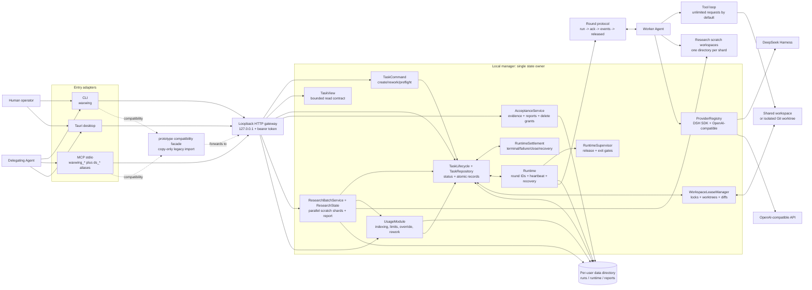
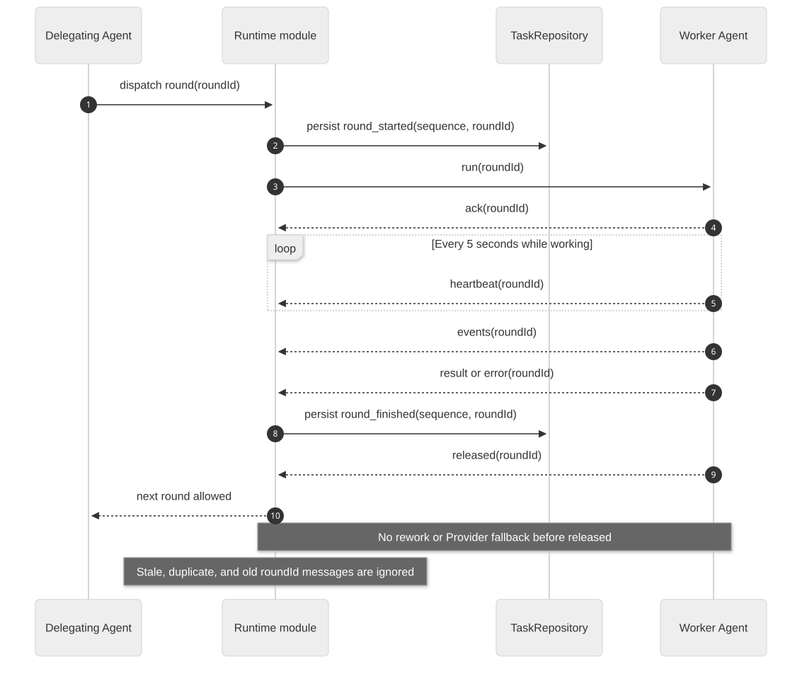

# Waxwing Architecture

Waxwing is a local-first delegation manager. CLI, MCP stdio, and the Tauri
desktop app are adapters over one loopback HTTP manager. The stable `0.1`
surfaces are those adapters; `POST /api` remains an internal, unstable
interface.



## Design boundaries

| Module | Responsibility |
| --- | --- |
| `src/app.mjs` | Public composition root and stable exports |
| `src/operations/catalogue.mjs` | One operation table: fields, defaults, bounds, entry exposure, annotations, shared validation, CLI parsing, and stable error codes used by the manager, CLI, MCP, and HTTP gateway |
| `src/config/paths.mjs` | One path resolution for launchers: `node cli.mjs paths` prints the data root, token file, HTTP URL, and manager script the desktop consumes |
| `src/config/service.mjs` | The only interpreter of provider files and editable settings: Node-side validation, naming, legacy local-config migration, and restart reporting |
| `src/storage/durable-file.mjs` | Atomic text/JSON writes with transient-rename retry, replace-with-backup transactions, and the shared SHA-256 |
| `src/adapters/cli.mjs` | CLI adapter; command parsing and help are generated from the operation catalogue |
| `src/adapters/mcp.mjs` | MCP stdio adapter with `waxwing_*` names and `ds_*` aliases; tool schemas come from the operation catalogue |
| `src/tasks/repository.mjs` | Task index, deeply frozen records, atomic `task.json`, and the single commit path: save the record, then append events with the next monotonic sequence |
| `src/tasks/lifecycle.mjs` | Legal task-status transitions and the shared active/terminal status sets used by the manager and research |
| `src/tasks/wait-loop.mjs` | One bounded wait loop (deadline, remaining-time arithmetic, `timedOut` result) shared by task and research waits |
| `src/tasks/transaction.mjs` | Create/stop transactions, rollback ordering, rework acceptance revocation, and the round-start record+event commit |
| `src/tasks/command.mjs` | Create command validation order and the immutable inputs the create transaction consumes |
| `src/tasks/rework.mjs` | One read-only rework decision: status/runtime/workspace/limit refusals, next-round limits, override record and event; shared by the rework action and status summary |
| `src/tasks/view.mjs` | Stable bounded list/summary/detail/page contract shared by CLI, MCP, Rust, and Vue |
| `src/view/page.mjs` | One paging rule: bounds, surrogate-pair safety, `nextOffset`, `complete` |
| `src/workspace/lease-manager.mjs` | Exclusive workspace leases, overlap checks, cleanup |
| `src/workspace/git.mjs` | Git probes, base commits, worktrees, status, diff, branches |
| `src/runtime/protocol.mjs` | Round IDs, every message constructor and validator shared by manager and Worker, the round-scoped message set, heartbeat constants |
| `src/runtime/module.mjs` | Single-round lifecycle: dispatch, ACK, heartbeat, terminal, release, exit, fallback handoff; owns the release and exit gates; a handle is retained until `forget`, so a failed final save stays retryable |
| `src/runtime/settlement.mjs` | One projection from every runtime fact (terminal, startup failure, fallback failure, ACK timeout, process error/exit, close, restart identity) to the task status, event, lease conclusion, and handle decision |
| `src/runtime/lifecycle.mjs` | Deprecated compatibility facade over `RuntimeSettlement`; removal at 0.3.0 |
| `src/runtime/outcome.mjs` | Deprecated alias of `RuntimeSettlement`; removal at 0.3.0 |
| `src/runtime/supervisor.mjs` | Deprecated facade over the Runtime release/exit gates; removal at 0.3.0 |
| `src/runtime/identity.mjs` | Residual-runtime identity verification |
| `src/acceptance/service.mjs` | Reports, hashes, deletion manifests, human grants; owns the report+record commit and the policy appendix |
| `src/research/state.mjs` | Shard-to-batch state machine, cancellation preservation, terminal classification, and `shardCapturePatch`, which decides what a captured shard view means |
| `src/research/repository.mjs` | Batch storage, atomic `batch.json`, and crash-window orphan reconciliation |
| `src/research/capture.mjs` | Evidence reader/writer for one shard: task result or workspace fallback, plus the error file |
| `src/research/report.mjs` | Aggregate report projection, atomic write, hash, and paging |
| `src/research/service.mjs` | Research orchestration over a narrow interface (`shardView`, `closeShard`, `cancelTask`): scratch workspaces, serialized refresh, partial results |
| `src/tasks/execution-policy.mjs` | Round-start policy read, bounded prompt appendix, and report provenance |
| `src/usage/execution-policy.mjs` | Deprecated forwarding import; removal at 0.3.0 |
| `src/usage/policy.mjs` | Limit validation, inheritance, threshold matrix, one-round override decision |
| `src/usage/metrics.mjs` | Usage metrics only: pricing, the incremental event index, and cost projection; no limits and no global configuration |
| `src/usage/module.mjs` | One usage seam: metrics plus limit inheritance, threshold evaluation, list flags, and the one-round override decision |
| `src/usage/service.mjs` | Deprecated compatibility adapter; production callers use `UsageModule` |
| `prototype/usage.mjs` | Legacy usage entry point forwarding to metrics and the module |
| `src/providers/registry.mjs` | Provider discovery, built-in provider names, adapter selection, declared capabilities, and task preparation |
| `prototype/providers/base.mjs` | Provider adapter interface: one round in, bare DSH-format events out, declarative capabilities |
| `prototype/providers/dsh-sdk.mjs` | DSH SDK adapter: one long-lived harness session, the task runtime patch, and the per-round budget file |
| `prototype/providers/openai-chat.mjs` | OpenAI-compatible adapter: tool loop, streaming, and an injectable HTTP transport |
| `src/worker/tools.mjs` | Worker-side bash/read/write tool set and executor |
| `src/providers/adapter-cache.mjs` | One adapter per Provider identity inside a Worker process |
| `prototype/manager.mjs` | `0.1.x` coordinator and compatibility facade |
| `prototype/` | Legacy entry-point and data compatibility until at least `0.2.0` |

`0.1` uses an incremental extraction rather than a full manager rewrite. The
service files above are the public module boundaries; several implementations
still delegate to battle-tested `prototype/` code. The coordinator remains the
single owner of a task lifecycle, so adapters and desktop commands never write
task state directly.

The release safety net discovers its inputs instead of listing them: the test
runner imports every `prototype/tests/*.test.mjs`, the release check requires
every `src/**/*.mjs`, and the portable desktop backend copies exactly the
`prototype/` files `package.json` publishes. Tests build Worker messages through
the same protocol module: `prototype/tests/fake-worker.mjs` is the only
spawned-process fixture, so a protocol change breaks one file instead of nine
hand-written copies.

The operation catalogue is the single source for the loopback gateway, CLI, and
MCP tool surface. It declares each operation's fields, bounds, defaults, entry
exposure, annotations, and cross-field rules; the manager validates and
dispatches from it, the CLI parses and prints help from it, and MCP renders its
tool schema from it. Entry-specific differences such as MCP's shorter `wait`
ceiling stay in the catalogue entry. HTTP failures keep their existing `error`
text and add a stable `code` (`INVALID_ARGUMENT`, `NOT_FOUND`, `CONFLICT`, and
so on) plus the matching status.

The desktop does not parse configuration. It asks the CLI once for resolved
paths, then reads and writes providers and settings through manager operations
(`providers_list`, `provider_save`, `provider_delete`, `settings_get`,
`settings_save`). Validation therefore uses the same registry and limit rules
as task creation; a saved provider or limit cannot fail later in `create` for a
reason the desktop did not see. Settings saves report `restartRequired` because
the manager read its limits at startup, while provider file changes are live.
The desktop task types are generated from the same contract fixture the Rust
and JavaScript tests read.

## Provider seam

`provider.type` selects exactly one adapter through
`src/providers/registry.mjs`; no other module branches on the type name. Each
adapter declares capabilities — reasoning effort, in-process session
continuity, and whether the task needs a runtime patch and a per-round budget
file — so the manager and the Worker ask the adapter what a round receives.
The DSH SDK adapter owns its harness session and the task runtime patch; the
openai-chat adapter owns its tool loop and accepts an injected HTTP transport,
so its tests need no loopback server. Both stream bare DSH-format events through
`onEvent`, and the Worker wraps each one with the round protocol before the
manager validates it.

## System view



The Mermaid source is kept in [assets/architecture.mmd](assets/architecture.mmd).
The checked-in SVG and PNG are rendered from that source so remote Git hosts
that do not render Mermaid still show the architecture.

```bash
npx -y @mermaid-js/mermaid-cli -i docs/assets/architecture.mmd \
  -o docs/assets/system-architecture.svg -b '#fff8fa' -t neutral --size 3000
```

## Single-round protocol

Each dispatch receives an opaque `roundId`. A result is not a release. The next
round, including automatic Provider fallback, may start only after the Worker
Agent relinquishes the previous lease.



The sequence source is kept in
[assets/round-protocol.mmd](assets/round-protocol.mmd).

```bash
npx -y @mermaid-js/mermaid-cli -i docs/assets/round-protocol.mmd \
  -o docs/assets/round-protocol.svg -b '#fff8fa' -t neutral --size 2200
```

```text
manager                         worker
   |-- run(roundId) ------------->|
   |<------------- ack(roundId) ---|
   |<---------- events/heartbeat ---|
   |<---- result|error(roundId) ----|
   |<----------- released(roundId) -|
   |-- next run ------------------->|
```

- A busy Worker Agent returns `worker_busy`; it never silently drops a run.
- Every message is built and validated by `src/runtime/protocol.mjs`. The
  Worker normalizes both Provider event wrappers into one nested
  `session.event`, and the manager rejects an unknown kind, a different
  protocol version, or a round message without a valid `roundId` before it is
  acted on. A rejected message is recorded as `runtime_message_ignored`.
- The manager records but ignores old, duplicate, or late messages whose
  `roundId` does not match the active lease.
- Every task event has a monotonic `sequence` and a `roundId`.
- Five-second heartbeats update health. Twenty seconds without a heartbeat
  marks the runtime `unhealthy`; it does not terminate the process.
- Runtime records include PID, task ID, start time, active round, and a random
  owner marker. Restart recovery terminates only a verified matching process.
  A live but unverifiable process keeps its workspace lock and requires human
  handling.

## Workspace modes

`workspaceMode=auto` is the default:

- A clean Git repository gets a sibling worktree under
  `.waxwing-worktrees/<task-id>` on branch `waxwing/task-<id>`.
- A non-Git directory uses an exclusive shared-workspace lock.
- A dirty Git repository returns `DIRTY_WORKSPACE`; the caller must explicitly
  select `shared` or clean the repository.

Acceptance and close stop the runtime but retain the worktree and branch.
`cleanup_worktree` removes only a clean worktree and never deletes the branch.

## Parallel research batches

`research_start` fans one read-only question out to multiple execution Agents.
Every shard receives a separate scratch workspace below
`<WAXWING_RESEARCH_ROOT>` (default `<WAXWING_HOME>-research`). Source projects
are referenced by URL or prompt and are not writable shared directories.

- Shards are dispatched concurrently through the same manager.
- `research_wait` blocks server-side until the batch settles or the caller's
  timeout expires.
- Successful shard runtimes close automatically after their result is captured.
- A failed shard does not discard results from completed shards.
- `research_collect` writes one aggregate report under `<WAXWING_HOME>/reports`
  and returns a bounded page plus a content hash.
- `research_cancel` stops unfinished shards and retains completed evidence.

The research service never reads a task record or a runtime handle. The manager
supplies three functions: `shardView(id)` returns the narrow view (status,
error, result text, finish reason, idle), `closeShard(id)` releases a finished
shard and returns `false` while it is still live, and `cancelTask(id)` stops an
unfinished one. `shardTransition` and `shardCapturePatch` in
`src/research/state.mjs` decide what each view means, so evidence
classification has one implementation and the research tests run without a
manager. The active/terminal status sets come from `src/tasks/lifecycle.mjs`,
and both task and research waits use `src/tasks/wait-loop.mjs`.

This supports parallel reading, source comparison, and synthesis. It does not
allow multiple execution Agents to write concurrently in one physical project
directory. Write tasks use separate worktrees or an explicitly serialized
`shared` workspace.

## Relationship to adjacent projects

| Project | Common ground | Waxwing's deliberate difference |
| --- | --- | --- |
| Heddle | Long-running Agent work, recovery, local control | No hosted control plane; Provider-neutral adapters and evidence-first acceptance |
| Vibe Kanban | Worktrees, task views, Agent execution | No Kanban or drag-and-drop board; CLI/MCP/desktop delegation with portable records |
| Generic Agent runners | Tool loops and streaming progress | Explicit Delegating Agent / Worker Agent roles, durable bounded APIs, and independent acceptance |

These comparisons are architectural, not claims about feature parity.

## Data layout

The default data root is `%LOCALAPPDATA%\Waxwing` on Windows,
`~/Library/Application Support/Waxwing` on macOS, and
`$XDG_DATA_HOME/waxwing` on Linux. `WAXWING_HOME` overrides it. `config.local.json` lives here so a portable or
package update cannot overwrite local settings; the older
`prototype/config.local.json` beside `config.json` is still read when the new
file is absent, and a save migrates it to the new location with its relative paths made absolute.

```text
Waxwing/
  config.local.json
  runs/<task-id>/
    task.json
    events.jsonl
    runtime.json
    runtime.log
    home/
    tmp/
  reports/<task-id>.md
  reports/research-<batch-id>.md
  research/research-<batch-id>/
    batch.json
    shards/<shard-id>.md
  providers/*.json
  runtime/server-token
```

Research scratch workspaces are stored outside the state directory by default:

```text
<WAXWING_HOME>-research/
  research-<batch-id>/
    <shard-id>/
```

On first start, legacy repository-local data is copied into the new root. The
legacy directory is retained. If the target is non-empty or migration fails,
startup reports the conflict rather than overwriting either side.
